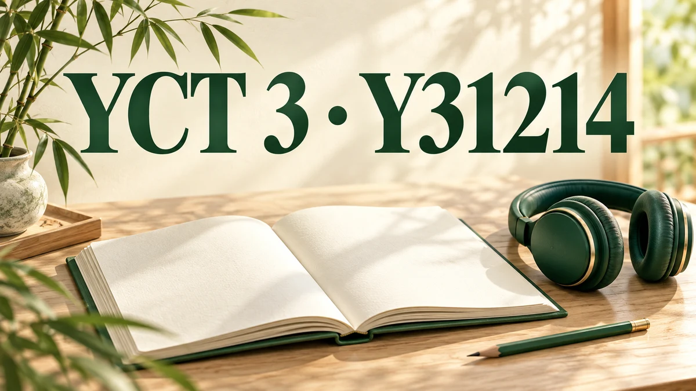

# YCT 3 · Y31214

Самостоятельный интерактивный тест по китайскому языку: 35 заданий на аудирование и 25 на чтение.

**Пройти тест:** https://deniszhi1.github.io/yct3-y31214/

## Запуск

Откройте `index.html` в браузере. Записи, картинки и оформление встроены в файлы теста; сервер, вход и подписка не требуются.
Сохраняйте `index.html`, `app.js`, `engine.js` и `test.css` вместе. После загрузки файлов тест работает без сети.

## Возможности

- Исходные аудиозаписи, пиньинь и картинки к заданиям.
- Варианты перемешиваются при новой попытке и сохраняют порядок при возврате к вопросам.
- Ответы можно менять и убирать до завершения. Попытка сохраняется в браузере.
- Досрочное завершение, отдельный итог по аудированию и чтению, разбор всех ответов.
- Результат можно скачать в JSON. Интерфейс адаптирован для телефона, планшета и компьютера.

Учебный результат показывает число верных ответов и не является официальным экзаменационным баллом YCT.

## Состав

`index.html` — разметка, учебные данные и встроенные аудио/картинки; `app.js` — интерфейс;
`engine.js` — попытки, перемешивание и проверка; `test.css` — оформление;
`asset-manifest.json` — исходные имена и контрольные суммы медиа; `generated-assets.json` — происхождение интерфейсной графики.

Для проверки данных и перемешивания: `npm test` (Node.js, без установки пакетов).

Оригинальные учебные материалы Y31214 предоставлены владельцем проекта. Интерфейсная графика создана через image_gen.
